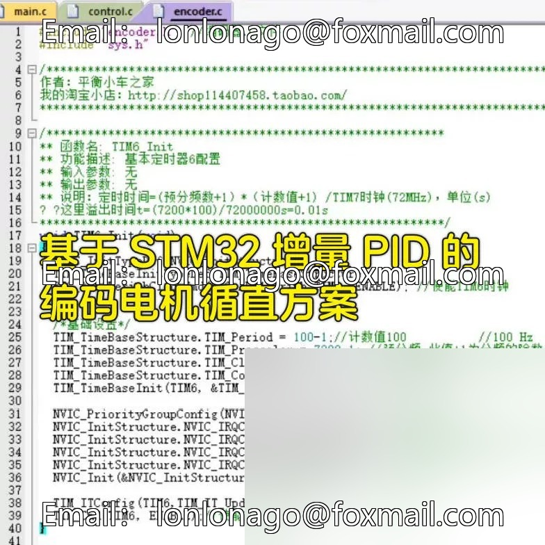
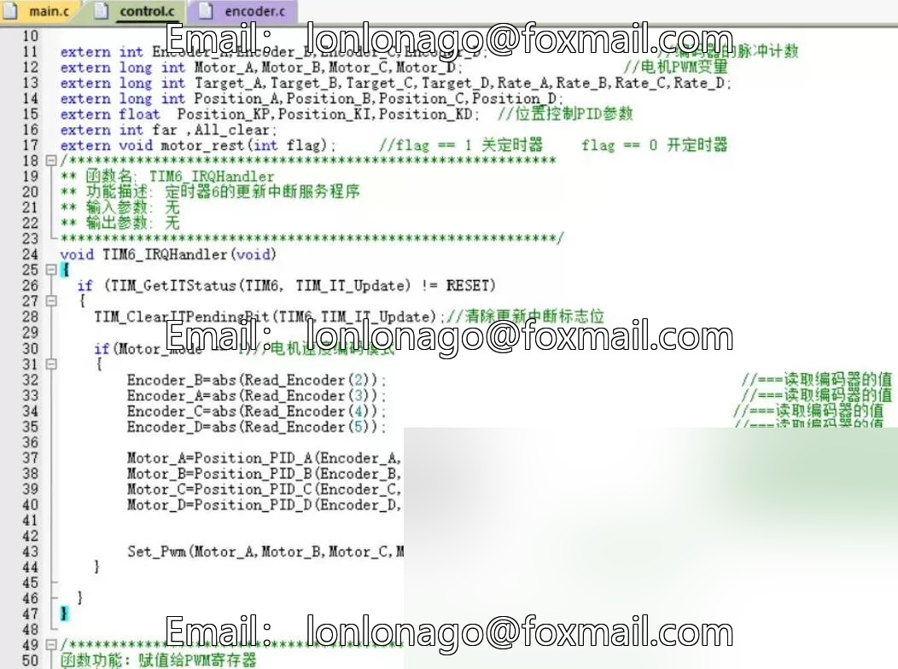

# STM32 microcontroller acquiring encoding values of AB-phase encoder and incremental PID control encoding.

## Body

STM32 microcontroller obtaining the encoded value of the AB phase encoder; incremental PID control of the encoder to control the speed of the motor, realizing things such as the car moving in a straight line, etc.
Based on STM32 incremental PID encoding motor straight path scheme, the embedded car is a classic set of solution.
Process: encoder → STM32 timer counting to calculate actual speeds of two wheels → compare with target speed → incremental PID calculates PWM adjustment amount → drives the motor.
Supplement: incremental PID compared with position PID, the calculation is simple, not easy to integral overflow, and is commonly used for motor speed adjustment.

web-based shipment, can be directly photographed and shipped.

The system implements incremental PID control for encoder-based motors for straight-line driving, including encoder counting, timer counting, and speed and position adjustment.

<!-- AI_ENRICHED -->

## Images

## Payment

Here is a pay link on Stripe ( https://buy.stripe.com/3cs8yP7sY87d0vu9AB ). Please contact me lonlonago@foxmail.com after funding $89, and I will send you a complete data files , thank you!

